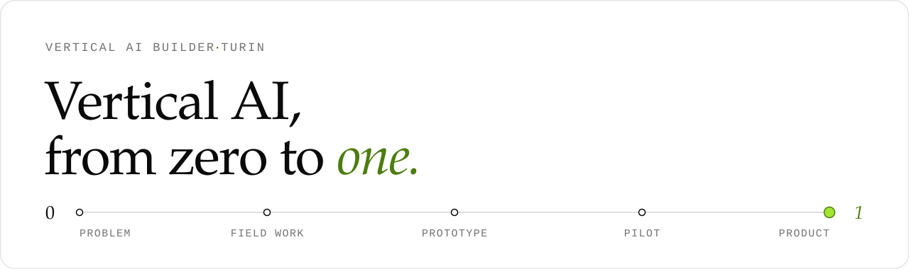
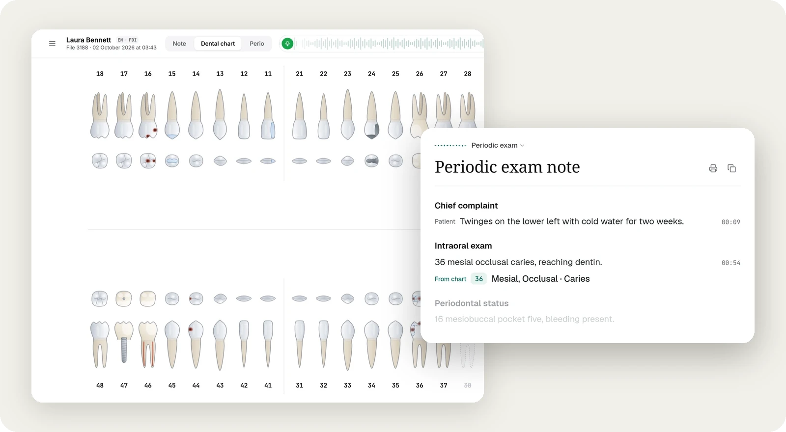

<picture>
  <source media="(prefers-color-scheme: dark)" srcset="assets/banner-dark.svg">
  
</picture>

 

I build AI-native software for small businesses whose day still runs on phone calls, paper and memory.
I take one problem from the first conversation to a product people use, and I design for regulation from day one.

 

## Now building · [Klinia](https://klinia-ai.vercel.app)

One AI team for the dental practice.
**Klinia Voice** listens to the exam and drafts the clinical note, tooth chart and perio chart.
**Alora** takes the front desk: missed calls, booking requests, follow-ups *(in development)*.
The dentist approves everything. Nothing becomes a record until they tap.

Sample exam, synthetic patient data.

- **Voice to structure.** Speech becomes a sectioned note, an FDI tooth chart and hands-free perio dictation, in Turkish and English.
- **Traceable by default.** Every line links back to its moment in the transcript. What the patient says is never written up as a clinical finding.
- **Draft, then approve.** An unclear command waits for review instead of being guessed. Approval is a tap, never a spoken "yes".
- **Private by design.** Built around KVKK and GDPR: audio is not kept, data stays in Türkiye and the EU, providers may not train on it.

Next.js · TypeScript · FastAPI · PostgreSQL · Deepgram · Gemini · Vercel

 

## How I build

**Start where the work happens.** Klinia's export format came from watching a hospital system in use, not from a spec.

**AI drafts, people decide.** The model never picks a billing code or confirms an appointment. It prepares; a professional signs off.

**When unsure, ask.** Uncertainty is a state in the data (`unclear`, `review_needed`), not a confidence score hidden behind a green check.

**Rules live in code.** Safety rules are written down, enforced in the pipeline and covered by tests.

**Ship the smallest real thing.** Alora's first release is one flow: a missed call becomes a short email to the dentist. No calendar yet.

 

## Toolbox

TypeScript · React · Next.js · Tailwind · Python · FastAPI · PostgreSQL · Supabase · Vercel · speech and LLM pipelines · Playwright

 

Turin · building for Türkiye and Europe
<!-- İletişim satırı: e-posta / LinkedIn / site gelince buraya eklenecek. -->
