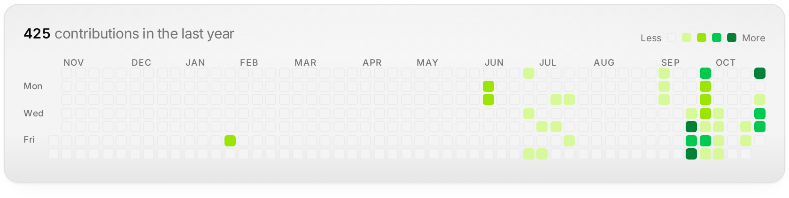

<h1 align="center">0 → 1 builder</h1>

I take an idea from the first conversation to a product people use.

TypeScript · React · Next.js · Tailwind · Python · FastAPI · PostgreSQL · 

 

<picture>
  <source media="(prefers-color-scheme: dark)" srcset="assets/activity-dark.png">
  
</picture>

 

### Now building

**[Klinia](https://klinia-ai.vercel.app)**: one AI team for the dental practice. Klinia Voice drafts the exam note, tooth chart and perio chart from speech; Alora handles the front desk. The dentist approves everything.

Sample exam, synthetic patient data.
